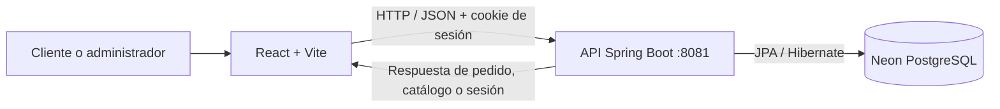

THE REYES RECORDS | Frontend React
Proyecto académico de tienda musical y servicios de disquera
Módulo: Desarrollo Fullstack II

1. ¿Qué es THE REYES RECORDS?
THE REYES RECORDS es una aplicación web que reúne una tienda de equipos para producción musical y una oferta de planes de servicios de disquera. El cliente puede revisar productos, agregar artículos al carrito, realizar una compra simulada y consultar sus pedidos. También desarrollamos pantallas para que un administrador gestione el catálogo.
El objetivo de este frontend fue pasar de páginas con contenido principalmente visual a una aplicación React conectada a un backend real, manteniendo el diseño de estudio musical con colores negro y dorado. El frontend no accede directamente a la base de datos: solicita la información a una API REST hecha con Spring Boot.
Alcance: proyecto académico. Los pagos se simulan; no se realiza ningún cobro bancario ni se reciben datos de tarjetas. Este README describe las funciones trabajadas y comprobadas durante el desarrollo; no equivale a certificar todos los casos posibles.

2. Resumen para el docente: ¿qué implementamos?
Área	Desarrollo realizado	Cómo se puede demostrar
React y navegación	Componentes JSX, React Router y vistas públicas/administrativas	Recorrer Inicio, Productos, Servicios, Checkout y Administración
Catálogo	Productos obtenidos desde Spring Boot y Neon; filtros Todos / Micrófonos / Interfaces	Cambiar filtros y abrir el detalle de un producto
Usuarios	Registro, inicio/cierre de sesión y recuperación de sesión tras F5	Iniciar sesión, recargar y cerrar sesión
Carrito	Agregar artículos, modificar cantidades, quitar artículos y calcular total en CLP	Añadir un micrófono y un plan con el mismo ID numérico
Planes musicales	Cuatro planes con botones funcionales, precio CLP y modal descriptivo	Agregar el Plan Básico desde Servicios
Compra	Checkout, petición al backend, pago simulado y confirmación con ID del pedido	Completar una compra de laboratorio
Historial	Pedidos consultados desde el backend, separando productos y planes	Abrir «Mis Compras» con sesión iniciada
Administración	Listar, crear, editar y desactivar productos	Mostrar el producto de laboratorio desactivado en Neon
Pruebas	Archivos .test.jsx con Vitest y React Testing Library	Ejecutar las pruebas y mostrar el resultado de consola

Cambios más importantes de la última integración
Antes, los botones de los planes mostraban un mensaje, pero no agregaban realmente el servicio al carrito. Además, los planes y los productos podían compartir un mismo ID. Se realizaron estos cambios:
1. CarritoContext.jsx: identifica los artículos mediante tipo + id, por ejemplo producto-1 y plan-1. Así un plan no reemplaza ni aumenta la cantidad de un micrófono con ID 1.
2. Servicios.jsx: conecta los botones de las tarjetas y el modal al carrito. Mantiene las imágenes y estilos originales.
3. ModalCarrito.jsx: permite sumar, restar y eliminar cada artículo según su tipo.
4. Checkout.jsx: envía al backend el ID, la cantidad y el tipo de cada artículo. Solo vacía el carrito cuando el backend confirma el pedido.
5. MisCompras.jsx: muestra dos secciones según corresponda: Productos Comprados y Planes Contratados.
6. Productos.jsx: se agregó filtro por categoría conservando las tarjetas existentes.
Planes y precios mostrados
Plan	Precio (CLP)
Básico	$50.000
Premium	$70.000
Gold	$85.000
Deluxe	$180.000

Decisión técnica: en la vista Servicios.jsx los datos de presentación de los planes son locales. Al registrar una compra, el backend obtiene el precio autorizado desde la tabla planes de Neon; el precio del navegador no se considera válido para cobrar. Queda como mejora obtener también el catálogo de planes desde una API pública, para mantener automáticamente ambos valores sincronizados.
3. Arquitectura y responsabilidades

- React: interfaz, rutas, formularios, estado local y presentación.
- Context API: AuthContext.jsx mantiene la identidad en React; CarritoContext.jsx administra los artículos seleccionados.
- src/services/api.js: centraliza las peticiones HTTP con credentials: "include", necesario para las sesiones del backend.
- Spring Boot: verifica usuarios, productos, stock, permisos y precios; registra pedidos.
- Neon: guarda usuarios, productos, planes y compras para recuperarlos aunque se cierre el navegador.
Flujo de ejemplo: contratación del Plan Básico
1. El usuario ingresa a Servicios y agrega el Plan Básico ($50.000 CLP).
2. El carrito guarda el artículo como plan-1, distinto de producto-1.
3. En Checkout se rellenan datos del cliente y se envía al backend tipo: "plan" con su ID y cantidad.
4. Spring Boot valida el plan, obtiene el precio en Neon y registra la compra simulada.
5. React muestra la pantalla de compra exitosa y vacía el carrito.
6. Con la sesión iniciada, Mis Compras obtiene el pedido desde la API y lo muestra en Planes Contratados.
4. Estructura principal del código
disquera/
├── public/                   # Imágenes de productos, planes y del sitio
├── src/
│   ├── components/           # Navbar, Footer, ModalCarrito, AdminSidebar
│   ├── context/
│   │   ├── AuthContext.jsx    # Estado de autenticación
│   │   └── CarritoContext.jsx # Productos y planes en el carrito
│   ├── services/
│   │   └── api.js             # Solicitudes HTTP a Spring Boot
│   ├── view/                 # Vistas React y pruebas .test.jsx
│   ├── App.jsx               # Rutas
│   ├── main.jsx              # Inicialización y providers
│   └── index.css             # Diseño general
├── package.json
└── README.md
Tecnologías: JavaScript/JSX, React 19, Vite 8, React Router 7, Bootstrap 5, React Bootstrap, Bootstrap Icons, Context API, Fetch API; para pruebas, Vitest 5, React Testing Library, jsdom y jest-dom.
5. Principales rutas para la demostración
Ruta	Vista
/	Inicio
/productos	Catálogo y filtros
/productos/:id	Detalle de producto
/servicios	Planes de disquera
/registro y /login	Registro y acceso
/checkout	Confirmación del pedido
/pago-exitoso	Resultado de pago simulado
/mis-compras	Historial del cliente autenticado
/admin	Inicio administrativo
/admin/productos	Gestión de productos
/admin/productos/nuevo	Crear producto
/admin/productos/editar/:id	Editar producto
/contacto, /nosotros, /albunes, /blog	Vistas de contenido

Nota sobre administración: las vistas de panel y usuarios existen, pero su conexión completa con información real y la protección de las rutas en React requieren revisión. Los permisos sensibles de modificación deben comprobarse en Spring Boot; ocultar un botón no sustituye la autorización del servidor.
6. ¿Cómo ejecutar el frontend?
Requisitos: Node.js y npm compatibles con Vite 8, y el backend iniciado en http://localhost:8081 con acceso a Neon.
git clone https://github.com/johao-riquelme/disqueraReact.git
cd disqueraReact\disquera
npm ci
npm run dev
Entrar a la URL que muestre Vite, normalmente http://localhost:5173/ (también podría utilizar 5174).
En el equipo de desarrollo se utiliza:
cd "C:\Users\jovit\Downloads\proyecto\disquera"
npm run dev
Para confirmar que el frontend compila:
npm run build
Si el catálogo indica que no se puede conectar, verificar primero que Spring Boot esté levantado y que http://localhost:8081/api/productos responda con JSON.
7. Pruebas y evidencias
La estructura del proyecto contempla archivos *.test.jsx asociados a vistas y componentes. Para esta etapa se siguió el criterio de un caso it() por archivo de vista/componente, incluyendo varias comprobaciones en el mismo caso cuando correspondía.
# Toda la batería de Vitest
npm run test -- --run

# Pruebas específicas trabajadas
npm run test -- --run src/components/ModalCarrito.test.jsx
npm run test -- --run src/view/Checkout.test.jsx
npm run test -- --run src/view/MisCompras.test.jsx
Resultados observados durante el desarrollo:
Evidencia	Resultado
ModalCarrito.test.jsx	1 prueba aprobada: coexistencia de producto y plan, total y acciones según tipo
Checkout.test.jsx	1 prueba aprobada: envía tipo correctamente y confirma la compra con respuesta simulada
MisCompras.test.jsx	1 prueba aprobada: renderiza productos y planes en el historial
Pedido N.º 5	Compra simulada del Plan Básico por $50.000 CLP confirmada en React, Neon y Mis Compras
Pedido N.º 4	Una compra anterior de producto siguió visible en el historial tras la ampliación
Producto de laboratorio ID 7	Desactivación lógica comprobada en Neon (activo = false)

Las pruebas automatizadas anteriores emplean mocks: comprueban los componentes, pero no modifican la base de datos. La compra del pedido N.º 5 fue una prueba funcional integrada distinta de la prueba unitaria.
Aclaración académica importante: la pauta de Evaluación Parcial 2 menciona Jasmine y Karma. El proyecto revisado utiliza Vitest, de modo que es necesario verificar con el docente si se admite esa alternativa o adaptar la configuración para cumplir literalmente la pauta. Tampoco se ha confirmado aquí una ejecución aprobada de toda la batería con la versión más reciente.

Orden sugerido para la demostración (5 minutos)
1. Mostrar el catálogo y filtrar micrófonos/interfaces.
2. Abrir Servicios y agregar el Plan Básico al carrito.
3. Mostrar cómo el carrito distingue plan-1 de producto-1.
4. Explicar Checkout, pago simulado y el pedido N.º 5 ya registrado.
5. Abrir Mis Compras y mostrar el plan junto a una compra antigua de producto.
6. Mostrar los resultados de Vitest en la terminal.
Para evidencias visuales en la entrega, se pueden agregar capturas sin datos privados en una carpeta docs/evidencias/ y enlazarlas desde este README; no se incluyen capturas no verificadas.
8. Alcance pendiente y siguientes mejoras
- Ejecutar todas las pruebas de forma conjunta con la versión final y documentar cobertura/resultados.
- Comprobar compras mixtas y los planes Premium, Gold y Deluxe; hasta ahora el flujo extremo a extremo confirmado fue el Plan Básico.
- Revisar la vista independiente de categorías, ofertas y manejo de pagos fallidos según la pauta.
- Completar o verificar el panel de usuarios y dashboard de administración.
- Reforzar el acceso a rutas administrativas del frontend y revisar seguridad junto con el backend.
- Entregar ERS actualizado (V2), documento de cobertura, evidencia de pruebas y presentación.
